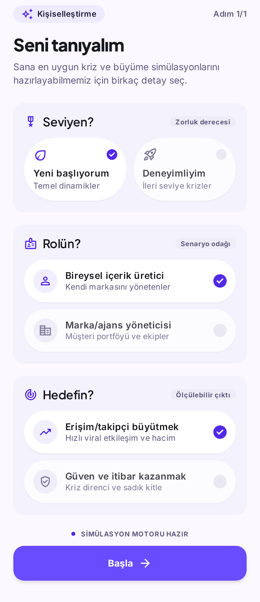
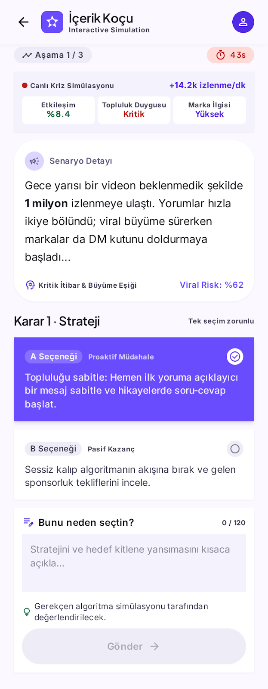
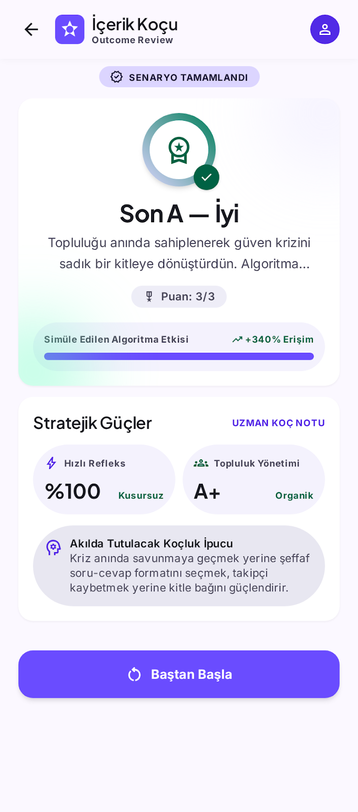

# DESIGN.md — İçerik Koçu

## Nasıl üretildi

Ekranlar [Google Stitch](https://stitch.withgoogle.com) ile üretildi. Aşağıdaki prompt stitch.withgoogle.com'a yapıştırılarak 3 ekran üretildi, PNG olarak dışa aktarılıp `design/` klasörüne eklendi.

**Kullanılan prompt:** bkz. [`stitch-prompt.md`](./stitch-prompt.md)

## 3 Ekran

### 1. Giriş (Onboarding)

- Amaç: oyuncunun seviye/rol/hedef bilgisini toplamak, bu bilgi sonraki her ekranı kişiselleştirir.
- 3 soru grubu, her biri 2 seçenekli büyük dokunma alanları (küçük metin linki değil — mobilde yanlış dokunmayı azaltır).
- Tüm sorular cevaplanmadan "Başla" butonu pasif — kullanıcıyı eksik veriyle senaryoya sokmamak için.

### 2. Sahne / Karar

- Amaç: krizi anlatmak, 2 seçenek arasında seçim yaptırmak, seçimin ardından yansıma yazdırmak.
- "Yeni başlıyorum" seviyesinde ipucu kutusu görünür (sarı, uyarı tonunda) — cevabı vermez, düşünmeye yönlendirir.
- "Deneyimliyim" seviyesinde ipucu yerine sağ üstte kırmızı bir geri sayım sayacı görünür — gerçek hayattaki zaman baskısını simüle eder.
- Seçim yapılınca seçenek mor renkle işaretlenir, yansıma kutusu açılır; yansıma yazılmadan "Gönder" pasif kalır.

### 3. Son

- Amaç: kararların toplam sonucunu (İyi/Kötü) ve kısa gerekçesini göstermek, puanı (X/3) şeffaf şekilde belirtmek.
- "Doğru/yanlış" rozeti yok; sadece gerçekçi bir sonuç anlatısı var.

## Tasarım Kararları

- **Tek vurgu rengi (#6a4cff, mor):** seçili durumu, birincil butonu ve AI tutor kutusunu ayırt etmek için tek bir renk kullanıldı; renk sayısını azaltmak mobilde netliği artırır.
- **Telefon çerçevesi (max-width 420px):** masaüstünde de gerçek mobil genişliği simüle etmek için.
- **İpucu vs. zaman baskısı:** aynı ekranın iki farklı kişiselleştirme durumunu (seviyeye göre) tek bir UI bileşeni (topbar'daki sayaç / içerikteki ipucu kutusu) ile çözdük, ayrı ekran tasarlamadık — gereksiz ekran çoğaltmaktan kaçınıldı.
