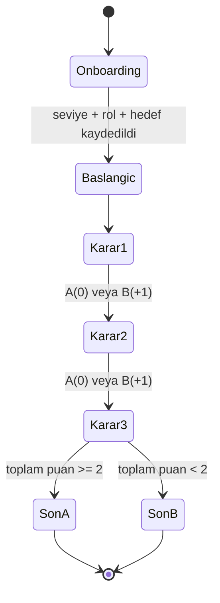

# spec.md — İçerik Koçu (SE Primer)

## Problem

İçerik üreticileri, stratejik kararlarının (veriye mi trend'e mi güvenmeli, hızlı mı yoksa doğrulayarak mı hareket etmeli, büyüme için mahremiyetten ödün vermeli mi) gerçek sonuçlarını önceden görmeden, deneme-yanılmayla öğreniyor. Bu primer, oyuncunun (içerik üreticisinin) bir kriz anında verdiği kararların **teknik/stratejik sonucunu** güvenli bir simülasyonda göstererek, cevabı dayatmadan düşündürür.

## Kapsam

### Yapılacak

- Telefonda açılan, tek bir bağlantıyla (AI Studio linki) oynanan uygulama
- Girişte 3 soru: **seviye** (Yeni başlıyorum / Deneyimliyim), **rol** (Bireysel içerik üretici / Marka-ajans yöneticisi), **hedef** (Erişim/takipçi büyütmek / Güven-itibar kazanmak); anlatı ve zorluk buna göre uyarlanır
- **1 senaryo, 3 sıralı karar, 2 farklı son** ("Gecede Viral Olma Krizi")
- Her karardan sonra: ne oldu, neden oldu (gerçekçi sonuç metni)
- Her karardan sonra oyuncunun yazdığı kısa yansımaya **AI tutor** (Gemini) yanıt verir: ipucu/soru sorar, doğru cevabı söylemez
- Kişiselleştirme: "Yeni başlıyorum" → her kararda ipucu kutusu görünür; "Deneyimliyim" → 60 saniyelik süre baskısı altında karar verilir (süre dolunca riskli seçenek otomatik seçilir)

### Kapsam Dışı

- Kullanıcı hesabı, giriş/kayıt sistemi
- İkinci senaryo/bölüm
- Gerçek takipçi/analitik verisi (üçüncü parti API entegrasyonu)
- Native mobil uygulama (yalnızca mobil tarayıcıda çalışan web uygulaması)

## Senaryo: "Gecede Viral Olma Krizi"

**Başlangıç:** "Gece yarısı bir videon beklenmedik şekilde 1 milyon izlenmeye ulaştı. Sabah hesabını açtığında yüzlerce mesaj ve bir marka işbirliği teklifi seni bekliyor."

- **Karar 1 · Strateji** — A) Aynı formatı art arda paylaş (riskli) · B) Son 24 saatin izleyici verisine bak, asıl içeriğe ilgiyi ölç (veri-odaklı)
- **Karar 2 · Doğrulama** — A) Marka teklifini hemen imzala (riskli) · B) Ürünü önce küçük bir kitleye test et (veri-odaklı)
- **Karar 3 · Mahremiyet** — A) Hedeflemeyi iyileştirmek için takipçi konum/mesaj verisine erişen 3. parti analitik aracına bağlan (riskli) · B) Sadece platformun anonim/agregat istatistikleriyle yetin (veri-odaklı)

**Puanlama:** Her "veri-odaklı" (B) seçim +1 puan. Toplam puan ≥ 2 → **Son A**, aksi halde **Son B**.

- **Son A · İyi** — "Takipçin kalıcı olarak büyüdü, marka ortaklığın uzun soluklu oldu, hiçbir gizlilik şikâyeti almadın."
- **Son B · Kötü** — "Viral an geçti, test edilmemiş ürün itibarını zedeledi, bir takipçi konum verisi paylaşımını fark edip seni ifşa etti."

## Kabul Örnekleri

1. **Given** seviye = "Yeni başlıyorum", **When** Karar 1 ekranına gelinir, **Then** ipucu kutusu görünür, süre sayacı gösterilmez.
2. **Given** seviye = "Deneyimliyim", **When** herhangi bir karar ekranına gelinir, **Then** 60 saniyelik geri sayım başlar; süre dolunca riskli (A) seçenek otomatik seçilir.
3. **Given** oyuncu 3 kararda da B (veri-odaklı) seçer, **When** son ekrana gelinir, **Then** puan 3 hesaplanır ve "Son A — İyi" gösterilir.
4. **Given** oyuncu 3 kararda da A (riskli) seçer, **When** son ekrana gelinir, **Then** puan 0 hesaplanır, "Son B — Kötü" gösterilir ve mahremiyet ihlali nedeni metinde açıkça geçer.
5. **Given** oyuncu bir karardan sonra yansımasını yazıp gönderir, **When** AI tutor yanıt üretir, **Then** yanıt hangi seçeneğin doğru olduğunu söylemez, bir soru veya ipucu içerir.

## Akış Şeması

## Not: AI Tutor'un gerçek kurulumu

Yansımaya verilen Sokratik yanıt, gerçek bir Gemini çağrısı ile (Google AI Studio'da) üretilir — statik/kalıp metin değildir. Sistem talimatı: *"Oyuncunun yazdığı yansımaya asla doğrudan 'doğru cevap X' deme; onu düşünmeye iten tek bir soru veya ipucu üret."* Yerel prototip (`app.js`) bu adımı sabit örnek metinlerle simüle eder; gerçek değerlendirme (`tutor-eval.md`) AI Studio uygulaması üzerinden yapılır.
